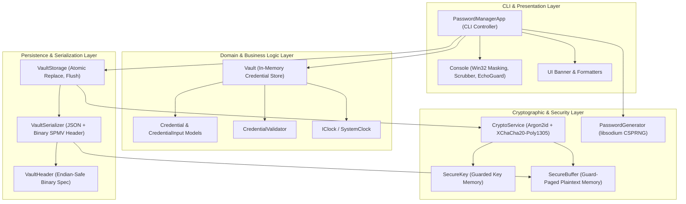
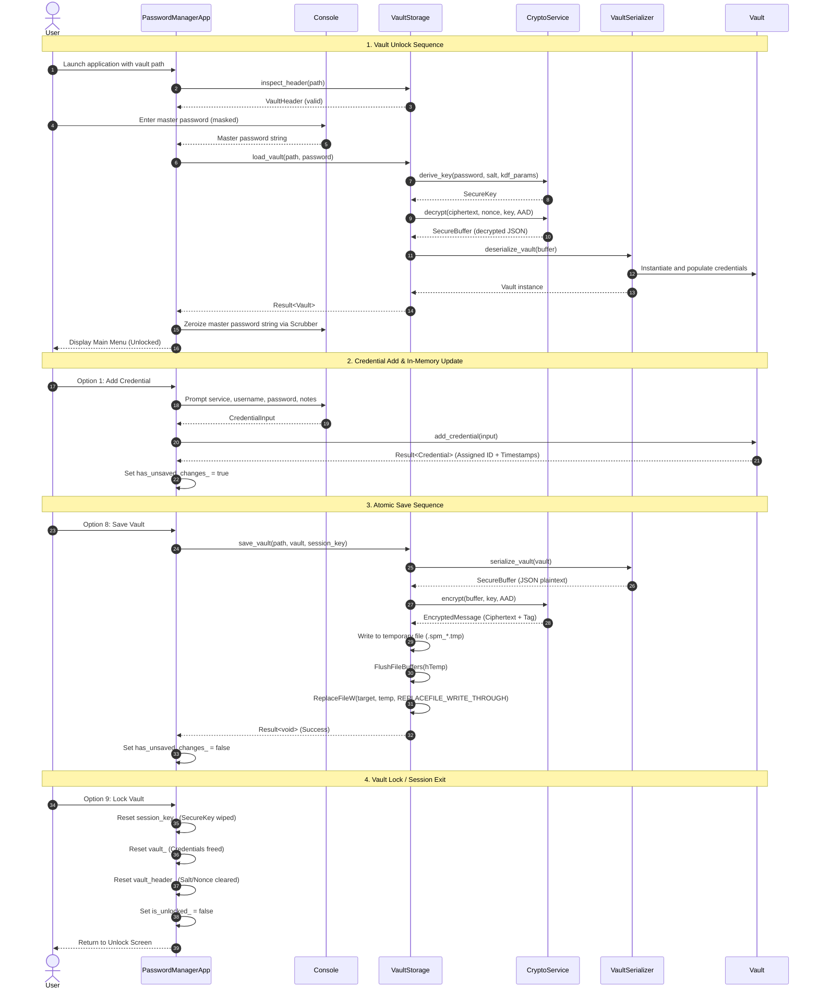

# Architecture and System Design

## 1. Overview and Design Principles

The Secure Password Manager is built as a layered, decoupled C++20 application prioritizing cryptographic correctness, memory safety, clean separation of concerns, and robust error management.

The architecture strictly separates user interaction, domain logic, cryptographic operations, and disk persistence. No layer bypasses intermediate abstractions.

---

## 2. Component Layers and Responsibilities

### 2.1 CLI & Presentation Layer (`password_manager::cli`, `password_manager::ui`)
- **`PasswordManagerApp`**: Orchestrates application lifecycle, menu navigation, unlock/create workflows, session state (`is_unlocked_`, `has_unsaved_changes_`), and action dispatch.
- **`Console`**: Provides platform-abstracted console I/O, Win32 terminal echo suppression (`ConsoleEchoGuard`), masked password inputs, stream redirection for tests, and zeroization helpers (`ScopedStringScrubber`, `secure_zero_string`).
- **`ui::display_welcome_banner`**: Renders version, build configuration, and application branding.

### 2.2 Domain & Core Layer (`password_manager::core`, `password_manager::models`)
- **`Credential`**: Immutable record representation holding `id`, `service`, `username`, `password`, `url`, `category`, `notes`, `created_at`, and `updated_at`.
- **`CredentialInput`**: User-supplied input transfer structure validated before credential instantiation.
- **`Vault`**: In-memory repository managing credentials, unique ID generation, duplicate detection, and search operations. Operates purely in memory with zero knowledge of disk or cryptography.
- **`CredentialValidator`**: Enforces service name non-emptiness, password presence, length limits, and URL syntax validation.
- **`IClock` / `SystemClock`**: Time abstraction providing ISO-8601 UTC timestamp generation and deterministic time mocking in unit tests.

### 2.3 Cryptographic Security Layer (`password_manager::core`)
- **`CryptoService`**: High-level cryptographic interface utilizing libsodium primitives exclusively:
  - Argon2id v1.3 password-based key derivation.
  - XChaCha20-Poly1305-IETF authenticated encryption with 192-bit extended nonces.
  - Verification of 48-byte Additional Authenticated Data (AAD).
  - CSPRNG random generation for salts and nonces.
- **`SecureKey`**: RAII wrapper encapsulating a 32-byte symmetric key inside an inline stack buffer (`std::array<unsigned char, 32>`). Automatically scrubbed via `sodium_memzero` on destruction and move. Move-only semantics prevent accidental copies.
- **`SecureBuffer`**: Dynamic-length sensitive data container backed by `sodium_malloc` page-protected memory.
- **`PasswordGenerator`**: Cryptographically secure password generation with configurable lengths, character sets, guaranteed category representation, and Fisher-Yates uniform shuffle.

### 2.4 Persistence & Serialization Layer (`password_manager::core`)
- **`VaultStorage`**: High-level persistence coordinator managing:
  - Header inspection and validation.
  - Vault file loading, decryption, and authentication.
  - Vault encryption and atomic replacement via Win32 `ReplaceFileW` and `FlushFileBuffers`.
- **`VaultSerializer`**: Converts between in-memory `Vault` instances and binary payloads. Handles JSON serialization/deserialization into `SecureBuffer` and binary `VaultHeader` formatting.
- **`VaultHeader`**: 80-byte fixed-size binary specification with little-endian encoding, algorithm identifiers, KDF parameters, and AAD bounds.

### 2.5 Error Handling Architecture (`password_manager::core`)
- **`Result<T>`**: Value-or-error vocabulary type (`std::variant`-based) enforcing explicit error propagation without exceptions across cryptographic boundaries.
- **`VaultError`**: Strongly typed error record pairing `VaultErrorCode` with descriptive context.

---

## 3. Credential Lifecycle & Data Flow

---

## 4. Key Design Decisions and Security Rationales

1. **Move-Only Cryptographic Buffers (`SecureKey`, `SecureBuffer`)**:
   - *Rationale:* Copying cryptographic keys or plaintexts across heap/stack buffers increases the attack surface for memory dumps and cold-boot inspections. `SecureKey` and `SecureBuffer` explicitly delete copy constructors and copy assignment operators.
2. **Explicit Binary Header as AAD**:
   - *Rationale:* The first 48 bytes of the vault file (version, magic, cipher ID, KDF limits, and salt) are bound to the Poly1305 MAC as Additional Authenticated Data. Any file manipulation of KDF limits or downgrade attacks breaks MAC verification immediately.
3. **Double-Ended File Flush and Atomic Replacement**:
   - *Rationale:* Writing directly to the active vault file leaves credentials vulnerable to truncation during power failures. Saving to a temporary file on the same volume followed by `FlushFileBuffers` and `ReplaceFileW` ensures write-through durability before pointer swap.
4. **Zero Heap Duplication on Password Reveal**:
   - *Rationale:* Revealing passwords streams directly to the output without allocating intermediate concatenated heap strings.
5. **No Exception Propagation Across Crypto Boundaries**:
   - *Rationale:* Exceptions can leak internal state and cause untracked unwind copies of sensitive buffers. All domain and crypto boundaries return `Result<T>` with strict status checks.
